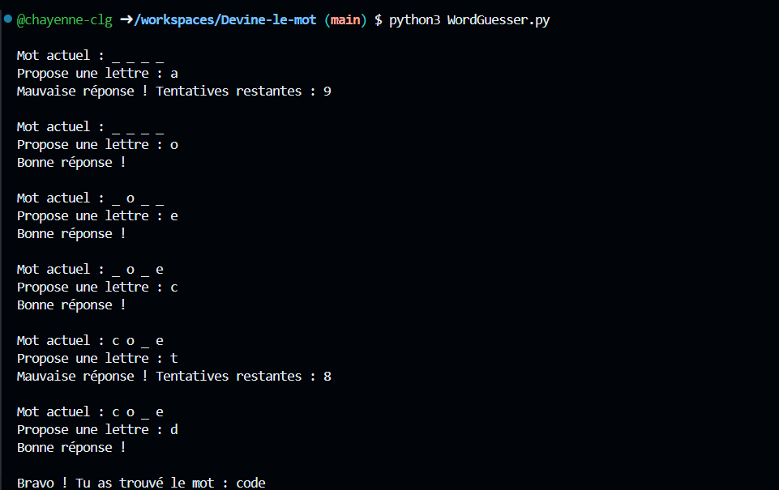

# Devine le mot

## Description

Jeu développé avec Python inspiré du jeu du pendu. Le but du jeu est de deviner un mot lettre par lettre avant de ne plus avoir de tentatives restantes.

## Fonctionnement

## Aperçu 

## Concepts utilisés

- Listes
- Boucles
- Conditions
- Fonctions

## Objectifs du projet
- Manipuler des listes et des chaines de caractères
- Découvrir comment programmer des jeux simples

## Auteur

Chayenne Le Gall
